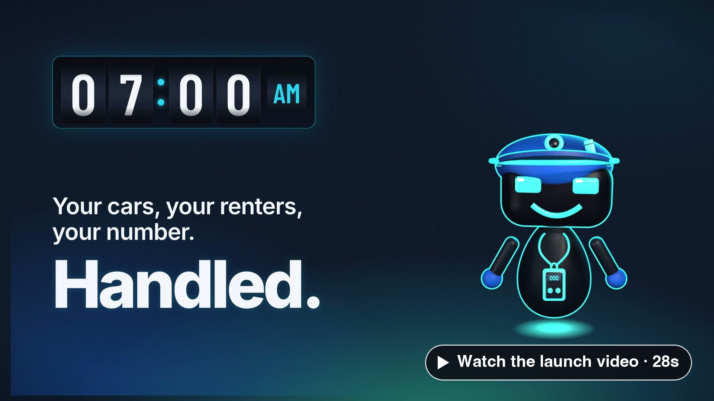
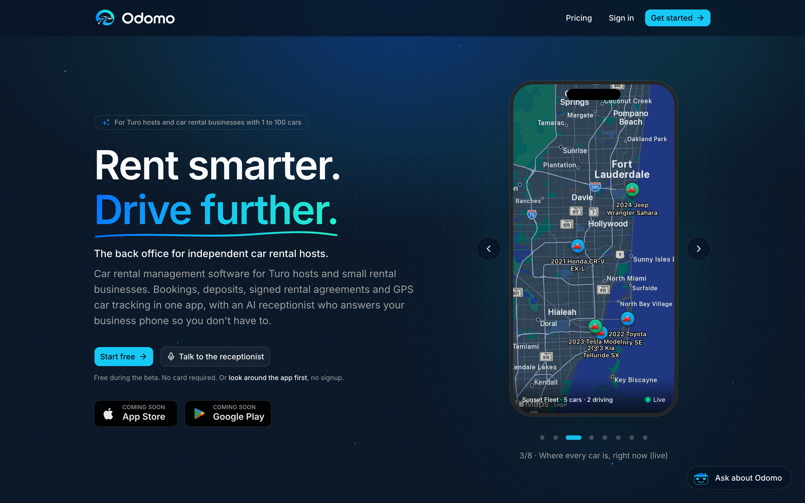
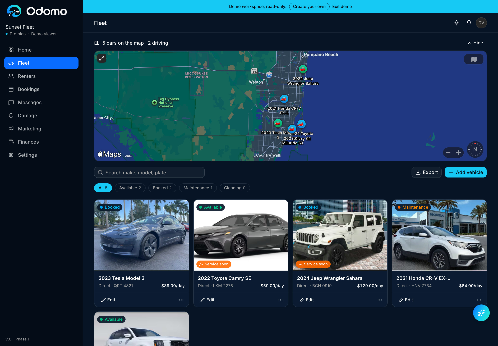
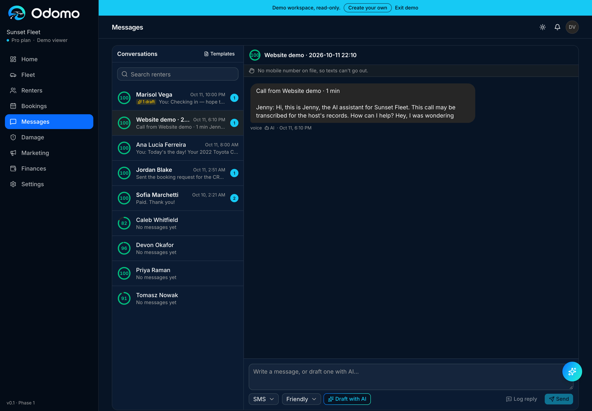
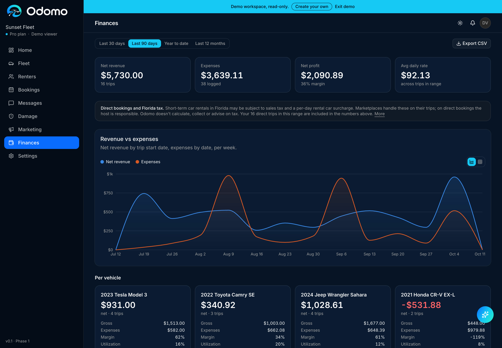

# Odomo

The back office for independent car rental hosts: bookings, deposits, signed rental agreements and GPS tracking in one app, with an AI receptionist who answers the business phone so the host doesn't have to.

▶ Launch video: [landscape 16:9 · 28s](media/odomo-launch-16x9.mp4) · [vertical 9:16 for mobile · 28s](media/odomo-launch-9x16.mp4)

**Live:** https://odomo.ai · **Demo workspace (no signup):** https://odomo.ai/demo

---

## What it does

Turo hosts and small rental operators run their business out of a platform inbox, a spreadsheet and their personal phone. Odomo puts every trip, renter, car and dollar in one place, and gives the host an AI receptionist that works the night shift.

At 2:14 AM a renter texts. Jenny, the AI receptionist, checks the fleet, quotes the trip, holds the car and sends the deposit link. The host wakes up to a confirmed booking.

### Core features

- **AI receptionist (Jenny)**: answers the business number by text and phone, quotes only from live availability, holds the car and sends the deposit link. Says she's an AI on every call, and hands off to the host for damage, disputes or anything legal
- **One calendar**: Turo, HyreCar and direct bookings on a single timeline, plus a direct booking page with no platform fee
- **Money**: deposits and balances by link into the host's own Stripe account; profit per car, utilization, Turo payouts checked against trips
- **Agreements and inspections**: rental agreements that fill themselves in and are e-signed on the renter's phone; photo and video inspections at pickup and return
- **GPS tracking**: plug-in trackers or the car's own connected app; alerts when a car moves without a booking or leaves the state
- **Also included**: automated guest messages, damage claims, renter screening, CSV import/export, co-host and inspector roles, two-factor sign-in

---

## Stack

Next.js 16 (App Router) · Supabase (Postgres, Auth, Storage) · shadcn/ui + Tailwind · Stripe · Vitest · Docker + Caddy, self-hosted

---

## Architecture notes

- **Multi-tenant by design.** Every domain table carries `org_id`, and every row-level-security policy is `org_id = current_org_id()`. New signups get their own org and owner profile from a database trigger
- **Public demo without accounts.** `/demo` opens a read-only sample workspace (Sunset Fleet, five cars), so anyone can look around the real app with no signup
- **Self-hosted.** The app runs in Docker behind Caddy on its own container; host-level crons drive message automation, and `/api/health` reports when they go stale

---

## Pricing

Free during the beta. After: Solo $49 · Pro $149 · Fleet $399 · Custom for 100+ cars

---

## Screenshots

App screens are from the public demo workspace, which uses sample data.

| | |
|---|---|
|  odomo.ai |  Fleet: every car on the map, with status and daily rate |
|  Messages: AI receptionist calls and texts land in one inbox |  Finances: revenue against expenses, profit per car |
